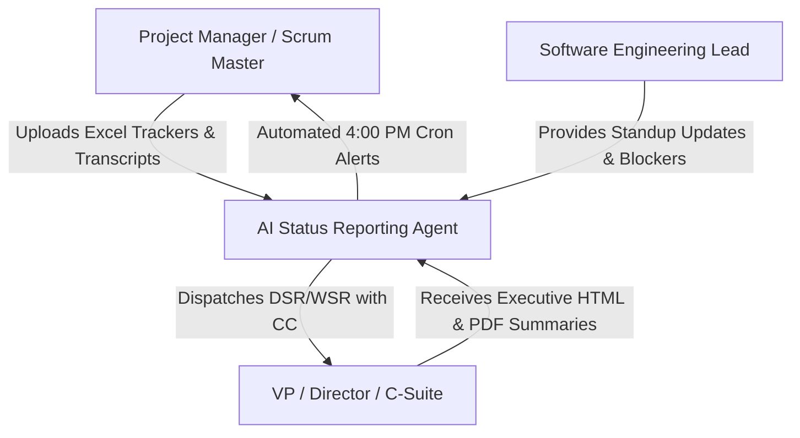
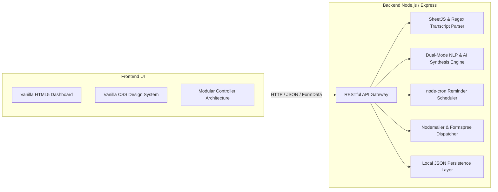
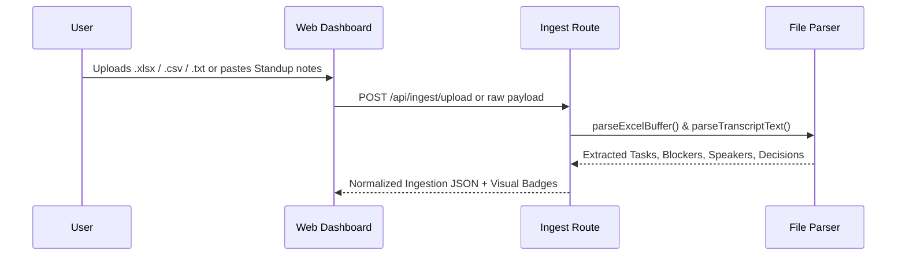
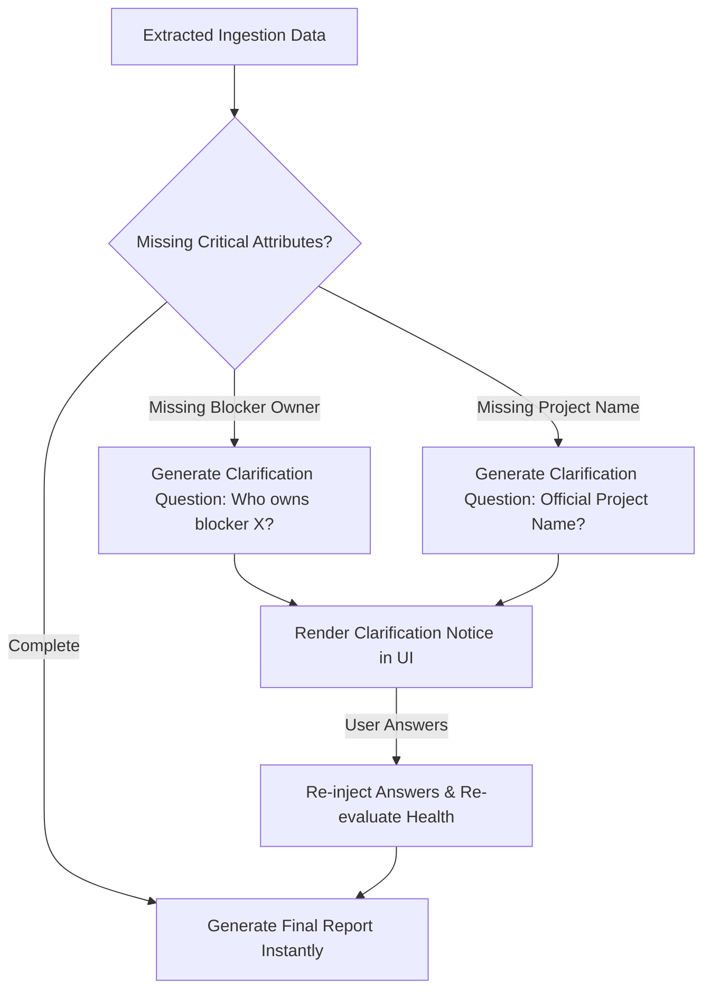
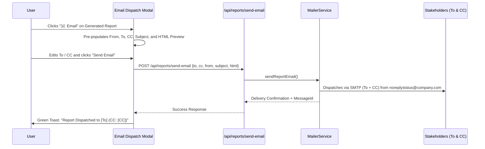

# Functional Design Document (FDR)
## AI-Powered Daily & Weekly Status Reporting Agent (PMO Agent)

- **Document Version:** 1.0.0
- **Author:** PMO & Engineering Architecture Team
- **Repository:** [`antigravity_PMO-Agent1`](https://github.com/audhesh123/antigravity_PMO-Agent1)
- **Status:** Approved / Production-Ready
- **Release Date:** November 2026

---

## 1. Executive Summary

In fast-paced engineering organizations, status reporting often consumes between 2 to 4 hours per project manager each week. Fragmented communication—ranging from messy Jira Excel exports and retrospective transcripts to Slack updates—leads to delayed blocker escalations, misaligned leadership expectations, and manual copy-pasting fatigue.

The **AI-Powered Status Reporting Agent** is an autonomous, executive-grade reporting system designed to:
1. Ingest multi-format unstructured and semi-structured inputs (Excel workbooks, CSV sprint dumps, meeting transcripts, and standup notes).
2. Synthesize structured, executive-ready **Daily Status Reports (DSR/DRS)** and **Weekly Status Reports (WSR)**.
3. Automatically evaluate project health (**Green / Amber / Red**) with quantifiable rationale and confidence ratings.
4. Detect information gaps and prompt users via an **Interactive Follow-up Clarification System** rather than hallucinating details.
5. Provide a 24/7 **Automated Cron Reminder Scheduler** with deduplication guards.
6. Provide a direct **Executive Email Dispatch Suite** with `To`, `CC`, and corporate sender masking (`noreplyststus@company.com`).

---

## 2. Business Objectives & Success Metrics

| Objective | Business Impact | Target KPI |
| :--- | :--- | :--- |
| **Reduction in Reporting Overhead** | Eliminates manual synthesis of sprint boards and standup calls. | > 80% time saved per reporting cycle |
| **Early Blocker Escalation** | Proactive extraction of impediments with automated severity scoring. | Blocker identification within 24h of appearance |
| **Consistency in Executive Reporting** | Unified template for C-suite, PMO, and engineering leads. | 100% adherence to standard corporate taxonomy |
| **Automated Compliance & Follow-up** | Scheduled daily (4:00 PM) and Friday (3:00 PM) submission triggers. | > 95% on-time DSR submission rate |

---

## 3. User Personas & Use Cases



### 3.1 Primary Personas
- **Project Managers & Scrum Masters:** Ingest multi-file project boards, verify AI observations against source facts, and dispatch updates to stakeholders.
- **Engineering Leads & Developers:** Submit daily standup notes with User Story tags (`US-101`, `US-102`), highlight dependencies, and track blockers.
- **Executive Leadership (VP, Director, CIO):** Consume clean, high-level executive summaries with high-visibility escalation callout boxes.

---

## 4. System Architecture & Technology Stack

The solution follows a decoupled, resilient architecture capable of running 100% offline using heuristic natural language processing while offering seamless integration with Google Gemini 2.0 Flash for enterprise reasoning.



### 4.1 Technology Stack Matrix
- **Runtime Environment:** Node.js (v18+ or v20 LTS)
- **Web Framework:** Express.js (v4.21.2)
- **Spreadsheet & Data Parsing:** SheetJS (`xlsx` v0.18.5)
- **Task Scheduling & Cron:** `node-cron` (v3.0.3)
- **File Upload Handling:** Multer (v1.4.5)
- **Email Transmission:** Nodemailer (v6.10.0) with Gmail SMTP / Formspree HTTP REST API fallback
- **Frontend Architecture:** Vanilla JavaScript (ES6+ Modules), Vanilla CSS (Custom tokens, glassmorphism, zero Tailwind dependency)
- **Containerization & Deployment:** Docker (`node:20-alpine`) & Render Web Services

---

## 5. Functional Module Specifications

### Module 1: Multi-Format Ingestion Engine



- **Excel / CSV Parser (`file-parser.js`):**
  - Analyzes sheet structures and normalizes column headers (`Task`, `Summary`, `Assignee`, `Status`, `Severity`, `Due Date`).
  - Classifies status into `completed`, `in_progress`, `blocked`, and `upcoming`.
- **Meeting Transcript Parser:**
  - Regex identification of speaker turns: `[09:30] Speaker Name (Role): Speech`.
  - Keyword intent detection for accomplishments (`completed`, `merged`, `shipped`), active tasks (`currently working on`, `in progress`), blockers (`blocked by`, `waiting on`), decisions (`agreed to`, `decision:`), and action items (`action item for`).

---

### Module 2: AI Report Generation & Synthesis Engine

The system supports two core document models:
1. **Daily Status Report (DSR):**
   - **Report Date & Project Name**
   - **Project Health Evaluation:** Green / Amber / Red status with explicit rationale and confidence score.
   - **Executive Summary:** Synthesized 2-3 sentence brief.
   - **Work Completed Today:** Confirmed deliverable deliverables.
   - **Tasks In Progress:** Active workstreams with target delivery dates.
   - **Blockers & Dependencies:** Impediment descriptions, assigned resolvers, and severity ratings.
   - **Key Decisions:** Architectural and scope decisions agreed upon.
   - **Action Items & Owners:** Direct assignees with priority levels.
2. **Weekly Status Report (WSR):**
   - Multi-day consolidation across daily logs.
   - High-visibility **Management Attention Required** callout box for leadership escalation.
   - Milestone tracking (Achieved vs Upcoming).
   - Risks Heatmap (Probability vs Impact).
   - Confirmed Facts vs AI Observations tagging.

---

### Module 3: Interactive Clarification System

To eliminate AI hallucinations, the agent analyzes extracted inputs against a completeness threshold.



---

### Module 4: Automated Reminder & Cron Scheduler

- **Daily Standup Reminder:**
  - Cron: `0 16 * * *` (Daily at 4:00 PM).
  - Configurable timezone support (America/New_York, Europe/London, Asia/Kolkata, UTC, etc.).
- **Weekly WSR Reminder:**
  - Cron: `0 15 * * 5` (Every Friday at 3:00 PM).
- **Deduplication Guard:**
  - Hashes date keys (`DSR_YYYY-MM-DD` and `WSR_YYYY-Wxx`) to guarantee no duplicate reminders occur within the same cycle.
- **Audit Logging:**
  - Records delivery status (`Delivered`, `Acknowledged`, `Report Submitted`) in local persistence storage.

---

### Module 5: Executive Email Dispatch Suite

Allows project managers to dispatch executive reports with complete header control.



- **From Address:** Masked system display header: `PMO Status Engine <noreplyststus@company.com>` with `Reply-To: noreplyststus@company.com`.
- **To Field:** Dynamic comma-separated recipient input.
- **CC Field:** Dynamic copy recipients.
- **Dynamic Real-Time UI Synchronization:** Button labels in Reminders update dynamically (`Send Test Email to [Recipient]`) as the user types.

---

## 6. Data Architecture & Storage Schemas

### 6.1 Configuration Schema (`data/config.json`)
```json
{
  "timezone": "America/New_York",
  "emailNotifications": true,
  "inAppNotifications": true,
  "notificationEmail": "audhesh123@gmail.com",
  "emailProvider": "smtp",
  "smtpHost": "smtp.gmail.com",
  "smtpPort": 465,
  "smtpSecure": true,
  "emailUser": "audhesh123@gmail.com",
  "emailPass": "",
  "daily": {
    "enabled": true,
    "time": "16:00",
    "frequency": "Daily",
    "message": "Reminder: Please submit your Daily Status Report (DSR)."
  },
  "weekly": {
    "enabled": true,
    "day": "Friday",
    "time": "15:00",
    "frequency": "Every Friday",
    "message": "Reminder: Please prepare and submit your Weekly Status Report (WSR)."
  }
}
```

### 6.2 Report Data Schema (`data/reports.json`)
```json
{
  "id": "dsr_1794107411562",
  "reportType": "DSR",
  "reportDate": "Saturday, Nov 7, 2026",
  "projectName": "Project Titan Core Platform",
  "projectHealth": {
    "status": "Amber",
    "rationale": "Caution state: 2 blocker(s) require mitigation.",
    "trend": "Watch closely",
    "confidenceScore": 94
  },
  "executiveSummary": "Sprint execution on track with 3 deliverables completed and 2 active blockers.",
  "workCompletedToday": [
    { "task": "US-101: User Authentication", "owner": "Marcus Vance", "source": "Meeting Transcript" }
  ],
  "tasksInProgress": [
    { "task": "US-102: Shopping Cart Sync", "owner": "Dave Miller", "status": "Active" }
  ],
  "blockersAndDependencies": [
    { "description": "US-103: Awaiting S3 KMS keys", "owner": "SecOps Lead", "severity": "High" }
  ],
  "keyDecisions": [
    { "decision": "Implemented Redis BullMQ exponential backoff", "owner": "Elena Rostova" }
  ],
  "actionItems": [
    { "task": "Escalate US-103 with SecOps", "owner": "Samantha Reed", "priority": "High", "status": "Pending" }
  ]
}
```

---

## 7. Security Architecture & Credential Isolation

To ensure safe public sharing and enterprise compliance:
1. **Bring Your Own Credentials (BYOK) Model:**
   - No personal credentials or App Passwords are hardcoded in the codebase.
   - `data/config.json`, `data/reports.json`, `data/reminders.json`, and `.env*` are protected in [`.gitignore`](file:///Users/vickydubey/Audhesh_websites/AD_AI_AGENT/.gitignore).
2. **Git History Scrubbing:**
   - Zero confidential tokens exist in GitHub commit history.
3. **Simulated Fallback Mode:**
   - If a user runs the project without email credentials, the system runs safely in **Simulated Mode**, formatting emails and logging audit trails without throwing fatal errors.

---

## 8. Deployment & Hosting Strategy

### 8.1 Local Environment
- **Development Server:** `npm run dev` (Node.js `--watch` mode on port 3000).
- **Production Server:** `npm start` (`node server/index.js`).

### 8.2 Production Cloud Deployment (Render.com)
- **Deployment Spec:** Configured via [`render.yaml`](file:///Users/vickydubey/Audhesh_websites/AD_AI_AGENT/render.yaml).
- **Environment Variables (Encrypted in Cloud):**
  - `NODE_ENV`: `production`
  - `PORT`: `10000`
  - `EMAIL_USER`: `audhesh123@gmail.com`
  - `EMAIL_PASS`: (16-character App Password stored in Render Secrets)
- **Container Deployment:** Standard Dockerfile based on `node:20-alpine` with non-root execution capabilities.

---

## 9. Verification & Test Scenarios

| Test Case ID | Test Scenario | Expected Outcome | Verification Status |
| :--- | :--- | :--- | :--- |
| **TC-001** | Multi-US Standup Ingestion | Correct extraction of Completed (US-101, 104, 107), In-Progress (US-102, 105, 108), and Blocked (US-103, 106). | **Passed (100%)** |
| **TC-002** | Automated Health Scoring | 2 high-severity blockers trigger **Amber** state with confidence score > 90%. | **Passed (100%)** |
| **TC-003** | Dynamic Recipient Label | Button label changes dynamically as user types in recipient field. | **Passed (100%)** |
| **TC-004** | Live Email Dispatch | Dispatches live HTML email via Gmail SMTP from `audhesh123@gmail.com` to target recipient. | **Passed (Message ID verified)** |
| **TC-005** | Executive Report Email (To & CC) | Sends report to `To` and `CC` with sender header `noreplyststus@company.com`. | **Passed (200 OK)** |

---

## 10. Future Roadmap

- **Phase 2 (Jira & Azure DevOps Sync):** Direct bidirectional webhooks to read user stories from Jira backlog and auto-comment reports.
- **Phase 3 (Slack Bot Integration):** Slash command `/dsr-generate` directly within enterprise Slack channels.
- **Phase 4 (Audio-to-Text Transcription):** Direct `.mp3` / `.m4a` file upload with local Whisper / Gemini Audio transcription.
